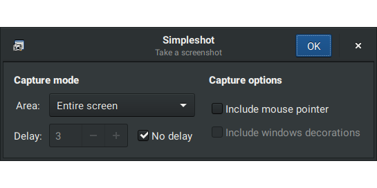
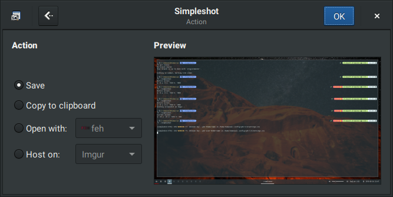

# Shotty

Shotty is the screenshot tool of the Luxe desktop: a simple GTK4 application for taking screenshots of the screen, a window, or a selected region.

&emsp;

## Features

+ Capture modes
	+ Entire screen
	+ Active window
	+ Selected region (via slop)
+ Delay
	+ Set a delay in seconds to wait before taking a screenshot
	+ Disable the delay with a single checkbox
+ Capture options
	+ Include/exclude the mouse pointer (screen and window captures)
	+ Include/exclude window decorations (active-window captures)
+ Actions
	+ Save to a PNG file
	+ Copy to the clipboard
	+ Open with an application of your choice

Screenshots are never uploaded anywhere: Shotty has no image-hosting support by design, and every capture stays on the local machine.

## Build and test

Configure and build with CMake:

```
cmake -S . -B build
cmake --build build
```

Run behavioral tests (isolated Xephyr/D-Bus, disposable configuration and a
build-tree schema; `xdotool` enables the real slop region-selection test):

```
ctest --test-dir build
```

Tests cover single-window activation, delayed capture cancellation, preview
ownership, failed/successful save paths, hand-off cleanup, reparented-window
geometry, cropped cursor placement, malformed X properties and region capture.

## License

GPL-3.0-or-later; see LICENSE. Based on upstream simpleshot-gtk by Tom Zaluckij; GTK4 port and Luxe integration by Jerry Howell (2026).
